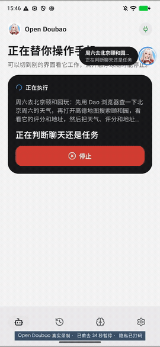
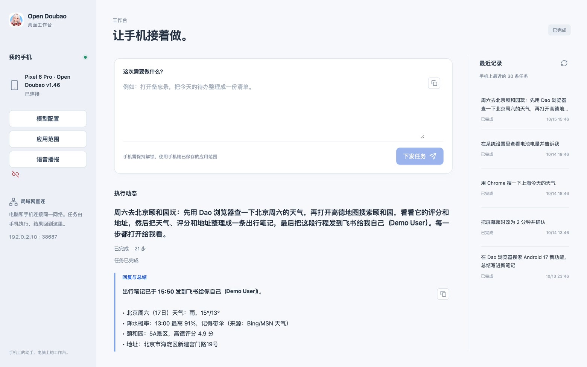

# Open Doubao · 豆馅

**一句话，让手机自己把事办完。**

一个真正能操作手机的开源 AI 助手。\
读懂页面、点击输入、跨应用完成任务，把结果带回给你。

[产品网站](https://open-doubao.moonrailgun.com) · [看它干活](#看它干活) · [安装与使用](docs/guide.md) · [豆馅 OS](os/custom/README.md)

Android 11+ · 手机独立运行 · 模型自由配置 · MIT

## 看它干活

> “周六去颐和园玩，查一下天气和景点评分，整理成出行笔记，再发到飞书给我自己。”

  
  
<b>一句话 → 4 个应用 → 21 步操作</b>

Dao 浏览器查天气 → 高德地图查景点 → 笔记整理行程 → 飞书发送给自己。

Pixel 6 Pro 真机实录，中途一次暂停后人工点击「继续」。上方为加速预览；这是单次演示，执行路径与耗时会随模型和应用状态变化。

[▶ 2 倍速录屏](website/assets/task-demo.mp4) · [▶ 完整实时录屏](website/assets/task-demo-realtime.mp4) · [落地页与本地预览](website/)

## 从手机，到电脑，再到系统

| | 你可以怎么用 |
| --- | --- |
| **手机助手** | 安装 Android 应用，说出或输入目标。手机自己完成观察、规划和执行，无需电脑、ADB 或 root。 |
| **桌面工作台** | 局域网扫码连接，在电脑上发任务、看进度、收结果，也能回看执行记录。无需自建服务器。 |
| **豆馅 OS** | 基于 AOSP 的定制系统。长按电源键或唤醒词叫出助手，纯查询任务可以在虚拟屏运行，前台手机照常用。 |

普通 Android 手机可以先用应用；虚拟屏和系统集成能力需要豆馅 OS，目前适配 Pixel 6 Pro。[看虚拟屏真机演示](website/assets/virtual-demo.mp4)

## 为什么这样做

- **先读元素，再看画面。** 优先读取界面结构，Jev 从候选动作里快速选择；拿不准时交给视觉模型理解当前页面。
- **做一步，再确认一步。** 执行前检查应用范围和页面状态，操作后重新观察；界面变了，旧操作就作废。
- **模型由你选择。** 自行配置模型服务与 Key，Jev 可选。任务循环在手机运行，模型推理由所配置的服务提供。
- **记得住，也看得清。** 偏好记忆可查看、修改和删除；任务过程、模型调用与结果可回看，便于复盘。

## 控制权留在你手里

可排除不希望助手访问的应用，随时停止任务，暂停后再继续。检测到密码输入框时由本地直接暂停；付款、删除等敏感动作的识别仍依赖模型判断，不能替代人工核对。

配置、记忆与任务记录在手机本地加密保存。任务所需的页面文字、记忆及截图会发送给你配置的模型服务，**不是完全离线运行**。

## 开始探索

当前为开发版，可从源码构建体验。

- [安装、配置与开发指南](docs/guide.md)
- [豆馅 OS 构建与刷机](os/custom/README.md)
- [Android 真机验收记录](android/acceptance.md)
- [产品落地页源码与预览方式](website/)

欢迎通过 [Issues](https://github.com/moonrailgun/open-doubao-phone/issues) 分享使用反馈，或提交 Pull Request 一起完善。

采用 [MIT License](LICENSE)。
