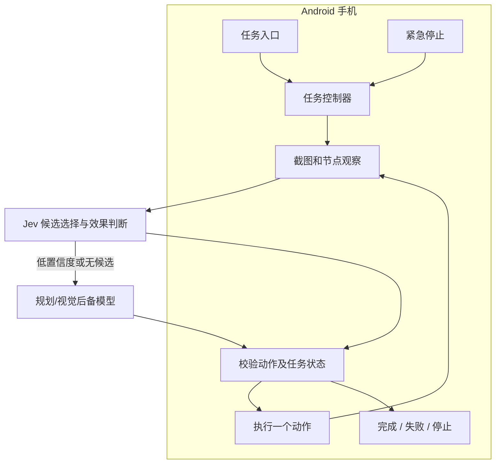

# open-doubao-phone Android 手机助手设计

日期：2026-10-08

状态：原生链路已在模拟器验证；2026-10-09 按用户要求改为全自动托管，移除逐步确认和暂停/继续。真实模型与真机验收尚未完成。

## 目标与前提

在用户的 Android 手机上安装独立 APK，通过自然语言任务完成屏幕理解和跨应用操作。任务循环、截图、动作执行和状态管理都在手机上运行；电脑仅用于开发、安装及调试，运行时无需电脑、ADB 或无线调试。

采用 Kotlin + Jetpack Compose + AccessibilityService，优先读取无障碍元素，使用 Jev 做快速决策和动作效果判断，必要时调用云端视觉模型。基础版本不要求 root、Shizuku 或厂商系统权限。

第一版按 Android 11 / API 30 及以上设计，面向用户主动发起、手机保持解锁的任务。2026-10-10 更新：目标设备已确定为 Pixel 6 Pro（`raven`），运行基于 Android 17 AOSP GSI 的豆馅定制镜像，助手以系统特权应用内置（见 `os/`）；下文的三星相关核实项改为在该设备上验证。

云端推理会发送任务相关截图、界面文字、用户目标和近期动作；这是该方案的工作方式，首次配置时明确展示上传范围。完全离线模型不在第一版范围内。

## 方案取舍

| 路线 | 取舍 |
| --- | --- |
| 原生 APK + 无障碍服务 + 云端模型 | 采用。手机独立执行，开发范围可控，能直接管理任务与紧急停止。 |
| 手机内运行脚本并连接无线 ADB | 不采用。增加配对、调试连接及后台运行依赖，不适合作为普通助手的基础。 |
| root / 系统级集成 | 不采用。需要额外设备条件，超出第一版的安装与维护范围。 |

普通 APK 不能复刻厂商助手的全部系统权限。安全窗口、敏感控件和部分应用界面可能无法观察或操作，遇到不可恢复的阻碍时结束任务并说明原因。

## 用户流程

1. 首次配置模型服务地址、模型标识和 API Key，检查连接；引导用户手动开启系统无障碍权限。
2. 首页输入任务，确认开始。支持文字与点击按钮调用系统语音识别。
3. 开始后自动连续执行，悬浮控制条显示当前进度和「紧急停止」。一次只运行一个任务。
4. 动作未生效或页面变化时自动重新观察、调整操作，不要求逐步确认或点击继续。
5. 完成后报告实际结果；不可恢复的阻碍或达到执行上限时结束并说明原因。单次点击成功不等于任务完成。

首页、模型配置页和任务详情使用普通 Android 页面。任务详情显示经过裁剪的文字记录，不默认保存截图。运行控制使用无障碍悬浮层。

## 组件与数据流

保持单个 Android 应用模块，不建立插件系统、通用自动化平台或多智能体编排。

| 组件 | 输入与输出 | 职责 |
| --- | --- | --- |
| 任务入口 | 用户目标 → 任务控制器；任务状态 → UI | 接收任务、配置模型、显示状态及历史。 |
| 屏幕观察器 | 当前可操作窗口 → 一份观察结果 | 生成截图、当前应用及窗口标识、屏幕方向和尺寸、精简节点信息。 |
| 模型客户端 | 目标 + 观察 + 近期动作 → 一个建议动作 | 手机直接通过 HTTPS 请求云端；解析和校验响应格式；支持取消请求。 |
| 任务控制器 | 用户任务 + 观察 + 动作结果 → 下一轮或终态 | 管理单步闭环、自动恢复、取消、超时和失败，不把任务调度移到云端。 |
| 动作执行器 | 已校验动作 + 当前观察 → 执行结果 | 调用系统 Intent、节点 action 或坐标手势，保留成功和失败信息。 |

不添加自建中转服务器。Jev 使用 TypeSafe `POST /v1/systemone` 的 `state + questions` 协议；规划、文字生成、摘要和视觉后备使用一种支持图片输入的 Chat Completions JSON 接口。服务地址和凭据由用户配置，不把示例地址当作已验证服务。

### Jev 快速路径

开始时由规划模型从用户目标生成子目标、目标应用和待输入文字。手机根据当前元素与这些已生成的文字构造有限的完整动作候选；Jev 只选择候选 ID，不能生成代码、坐标或新文字。一次请求合并下一步选择、上一步效果与完成判断。低置信度或 `none` 才调用较大的模型重新理解页面；元素充足时不截屏，也不在每一步先调用大模型。

Jev 的分布置信度不是安全或成功保证。屏幕内容是不可信任务数据，动作始终经过本地白名单、参数和新鲜度检查。完成判断还需生成有观察依据的结果，点击 API 返回成功本身不能结束任务。

用户选择允许访问的应用并开始任务后，范围内的普通动作自动执行，不再逐步确认。动作始终绑定当前观察；界面变化后丢弃旧建议并重新决策。被禁止的敏感提交直接结束任务并说明原因。

## 观察与执行约定

无障碍服务声明截图、读取窗口内容和执行手势能力。仅处理当前任务需要的前台内容，限制节点文本长度和数量，不发送完整历史。

Android 14 / API 34 及以上优先截取目标窗口，避免自己的悬浮层遮挡。Android 11–13 截屏前短暂隐藏悬浮层，成功或失败都恢复显示。窗口外区域遮黑；低版本遇到其他遮挡窗口时结束任务。截图期间页面变化则重新观察，系统拒绝截图（包括频率限制和安全窗口）则结束并说明原因，不用空白图片继续推理。

动作优先级为：明确的系统 Intent、可访问节点操作、坐标手势。每次只派发一个动作，等待结果后重新观察。

支持以下固定动作：

- 打开指定应用。
- 点击一个节点或屏幕位置。
- 向一个可编辑节点填写文字。
- 滚动或滑动一次。
- 系统返回、回到桌面。
- 等待界面变化。
- 报告无法完成及原因。
- 报告完成。

模型响应是建议，不是可执行程序。只解析已支持的动作及参数，不使用 `eval`、任意脚本或 Shell。坐标必须处于当前目标应用窗口边界内，且不能覆盖已知敏感控件或被其他窗口遮挡；节点引用仅对当前观察有效。

执行前再次确认任务有效、目标应用和窗口一致、方向与尺寸未变。目标已变化或节点失效时，丢弃建议并重新观察；这些检查不能完全消除界面变化带来的竞态，仍需真机验证。

节点 action 的返回值、手势提交失败及手势取消都必须传回控制器。不能把“已调用接口”当作执行成功。动作后等待界面事件短暂稳定，并设等待上限，再获取新观察确认效果。

## 任务状态与停止语义

状态包括：空闲、运行中、已完成、已失败、已停止。

- 开始：从空闲或终态创建新任务，分配任务标识与执行版本。
- 自动恢复：重新观察页面及上一步的实际派发结果，让模型调整下一步；不直接重放失败的动作。
- 紧急停止：取消请求，使旧版本响应失效并结束任务；下一次运行必须由用户重新开始。停止不关闭系统无障碍权限。
- 已注入系统的手势可能继续完成；停止不能撤销已经发生的点击或输入。保证的是停止后不再派发新的动作。
- 锁屏、无障碍服务断开或权限失效：中止当前执行并说明原因；服务重新连接不自动续跑。
- 进程被终止：不恢复执行。此前运行中的历史记录标记为中断，等待用户重新发起。

无障碍服务由系统绑定和管理，在连接时初始化，在断开或销毁时取消任务。不仅为了无障碍服务本身添加另一个常驻前台服务；后续语音功能如涉及额外权限和生命周期，单独处理。

初始限制使用代码常量：单任务最多 30 步、总时长 5 分钟、单次模型请求超时 60 秒；连续三次无界面进展则调用视觉模型调整，六次仍无进展且不能确认完成时结束。连续六次决策期间页面变化也会结束。限制值是初始工程选择，后续按真机结果调整，第一版不增加对应设置项。

## 异常、数据与权限边界

断网、模型响应无法解析或动作不支持时，不执行猜测动作，说明原因并结束。可恢复的页面变化和动作失败先检查当前结果再重新决策；可能产生外部副作用的动作不能盲目重复。

第一版以搜索、读取、普通设置和草稿填写为范围。实际发送消息、付款、下单、删除及账号安全变更交给用户操作；不依赖模型自行判断并承诺识别所有敏感页面。验收任务中不包含这些自动提交操作。

自动执行范围落实到本地：目标应用必须在用户所选范围内，节点必须有效且可操作，敏感标签和密码控件会被拒绝；坐标必须在目标窗口内，不命中敏感区域或被遮挡，并通过派发前截图校验。超出允许范围时结束任务。标签检查不能识别所有敏感页面，也不等同于系统级权限隔离；目标应用更新后仍需重新验证。

屏幕内容属于任务数据，不能改变用户目标、扩大动作权限或要求泄露凭据。模型提示词与本地动作校验都保持这个边界；不宣称提示词可以完全防止页面诱导。

API Key 使用 Android Keystore 管理的密钥加密后保存，凭据不进入日志或设备备份。任务历史只保留目标、时间、状态及必要的文字摘要，提供删除入口；不记录输入的密码、验证码和完整模型请求。截图在内存中按需处理，默认不落盘。

无障碍权限必须由用户开启。侧载安装可能遇到系统“受限设置”步骤，安装说明按实际系统版本给出，不尝试绕过系统限制。

## 交付顺序与验证

### 第一阶段：原生执行能力

创建最小 Android 工程及无障碍服务，验证截图、读取节点、打开应用、点击、输入、滑动、返回。验证悬浮层不污染截图，动作失败能正确返回，紧急停止后不再派发新动作。

### 第二阶段：模型闭环

连接 Jev 和规划/视觉接口，完成响应解析、自动任务循环、状态管理和恢复。对动作解析、无效参数、迟到响应、停止竞态、步数上限及重复无进展分别做小型单元测试；系统手势和截图效果通过设备验证。

### 第三阶段：助手交互

补齐系统语音输入、任务记录和状态说明。复用系统语音识别能力，不做常驻唤醒或自行训练语音模型；设备语音服务的可用性在接入时核验。

### 真机验收标准

根据实际已安装的应用，固定浏览器、备忘录和一个可安全测试的设置页面，记录应用版本及任务初始状态。下列任务各重复三次，逐次记录结果；这是第一版验收样本，不等同于通用成功率。

1. 在浏览器搜索指定主题，读取结果并给出有来源的摘要。
2. 修改一个预先指定、可恢复的普通应用设置，随后观察并确认结果。
3. 将浏览器搜索结果的摘要写入备忘录草稿，并确认文字已保存。

验收时拔掉 USB、关闭无线调试，仅保留手机网络。必须仍能完成任务，证明运行时不依赖电脑。

同时验证：模型请求途中停止后不再派发动作；页面变化和动作失败时自动重新观察；普通连续操作无需用户确认；断网、锁屏、权限撤销、系统拒绝截图和进程重启后不继续盲目执行；不支持的动作及越界参数被拒绝；模型提出范围外的提交动作时结束并记录原因。

## 尚待实施阶段核实的事实

- 手机型号与系统版本（已确定：Pixel 6 Pro / Android 17 AOSP GSI）；语音改用本地 SenseVoice 与独立 TTS 引擎，见豆馅 OS 计划。
- 目标设备的后台回收、无障碍服务重连及悬浮层截图行为。
- 固定目标应用的节点完整性、文字输入能力和安全窗口限制。
- 选定模型服务的可访问性、协议、延迟、费用及实际操作准确率。

这些是设备与服务验证项，不改变已选择的架构。若系统低于 Android 11，先报告与本设计的兼容性差异，再决定是否增加其他截图通道。

## 参考依据

- [Android AccessibilityService](https://developer.android.com/reference/android/accessibilityservice/AccessibilityService)：服务生命周期、截图和手势 API。
- [Android 无障碍服务指南](https://developer.android.com/guide/topics/ui/accessibility/service)：服务能力声明及节点交互。
- [无障碍悬浮层](https://developer.android.com/reference/android/view/WindowManager.LayoutParams#TYPE_ACCESSIBILITY_OVERLAY) 与 [安全窗口限制](https://developer.android.com/reference/android/view/WindowManager.LayoutParams#FLAG_SECURE)。
- [Open-AutoGLM](https://github.com/zai-org/Open-AutoGLM)：手机模型及动作设计参考；不直接沿用桌面 ADB 执行框架。
- [MobileAgent-Android](https://github.com/GiggleWang/MobileAgent-Android)：Android 实现参考；不直接引入其完整多阶段推理与本地模型构建链。
